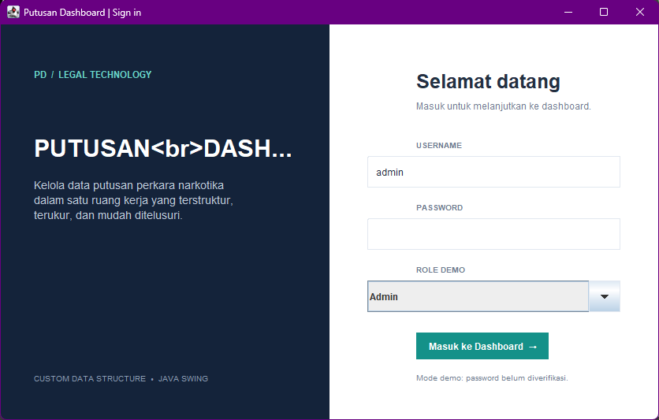
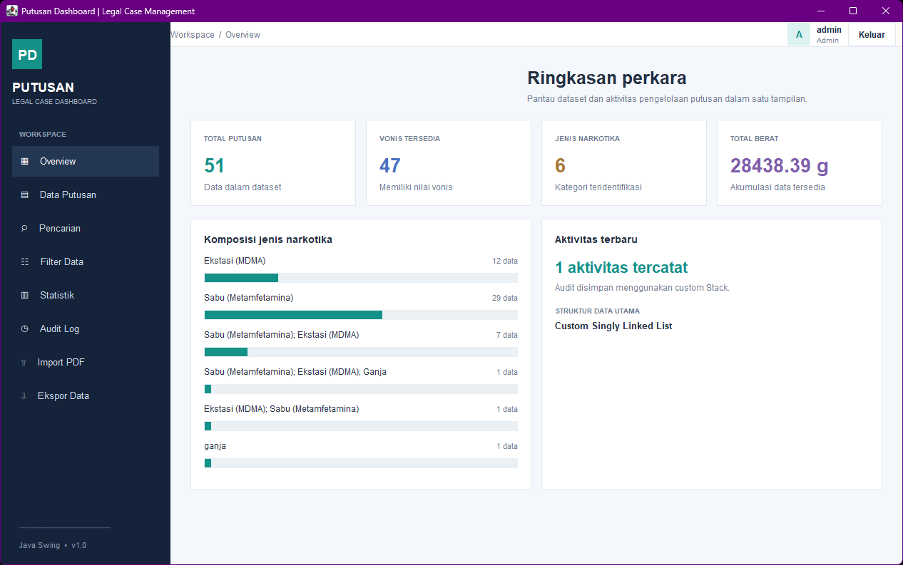
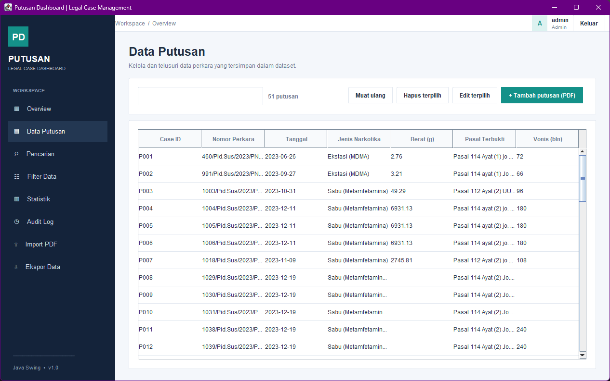
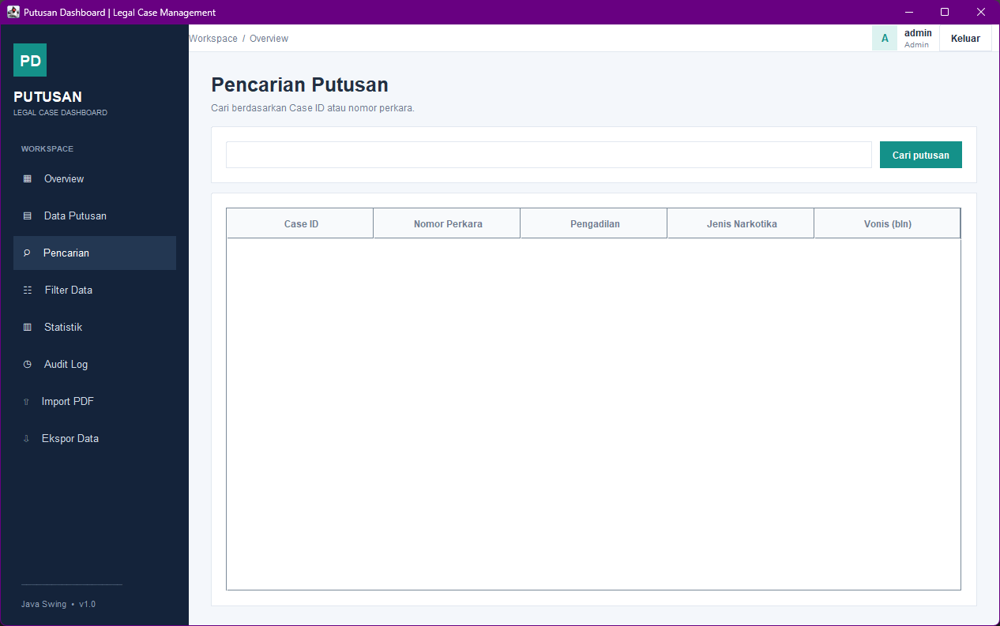
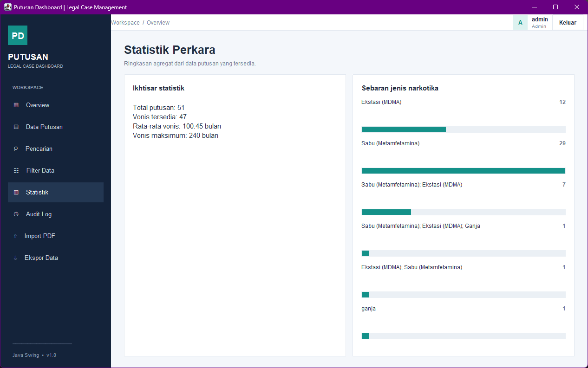

# PUTUSAN DASHBOARD

Aplikasi desktop Java 21 + Swing untuk mengelola dataset 50 putusan perkara narkotika. Penyimpanan utama runtime menggunakan **Custom Singly Linked List** dan audit aktivitas menggunakan **Custom Stack**.

## Menjalankan
1. Pasang JDK 21 dan Maven 3.9+.
2. Buka terminal pada folder root proyek.
3. Jalankan `mvn clean test`.
4. Jalankan aplikasi dengan `mvn exec:java`.
5. Pastikan working directory adalah root proyek agar `data/putusan-50.csv` ditemukan.

## Login dan logout
Login masih berupa simulasi lokal: username tidak boleh kosong, password belum diverifikasi, dan role dipilih pada layar login. Tombol **Keluar** di kanan atas dashboard menampilkan konfirmasi, mencatat aktivitas LOGOUT pada `logs/audit-log.txt`, menutup dashboard, lalu kembali ke layar login. Autentikasi sungguhan, registrasi, dan pembatasan hak akses sengaja belum diimplementasikan pada tahap ini.

## Fitur
- Dashboard ringkasan, tabel data, tambah, edit seluruh 16 atribut, dan hapus data.
- Pencarian tabel dan pengurutan kolom.
- Filter jenis narkotika, berat, dan pasal melalui panel filter.
- Statistik, audit log berbasis Stack, dan ekspor CSV/TXT.
- Ekstraksi text layer PDF untuk pratinjau; PDF hasil scan memerlukan OCR.
- Penyimpanan tambah/edit/hapus ke `data/putusan-50.csv` secara otomatis.
- Pembacaan CSV menghapus UTF-8 BOM dari header pertama agar `caseId` tidak hilang saat pemuatan.

## Dataset dan provenance
`data/putusan-50.csv` berisi 50 putusan dan 16 atribut. `data/data-provenance.csv` dan `docs/data-provenance.csv` menyimpan catatan provenance. Nilai yang tidak tersedia tetap kosong/null dan tidak diisi dengan tebakan.

**Catatan cakupan:** seluruh 50 dokumen dalam paket ini berasal dari Pengadilan Negeri Pekanbaru. J

### 1. Login

### 2. Dashboard

### 3. Data Putusan

### 4. Import PDF

### 5. Search dan Filter

### 6. Audit Log

